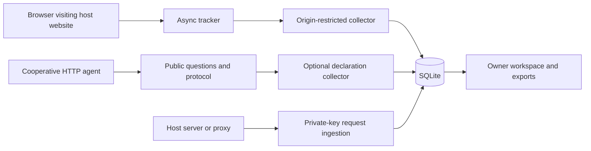

# Arrival architecture

Arrival is an observability layer. A website's content stays available while visitors optionally share task context. Detection, declared intent, observed activity and access control are separate concepts.

## Browser collection

A public script and site ID install without a package or private key. The optional static manifest link exposes question discovery in the original HTML. `public/tracker.js` reports page views, bounded environment hints, scroll milestones, visibility and explicitly annotated clicks. It observes pathname changes through browser history, skips query-only changes, prevents duplicate initialization and resumes the server-issued visit token from per-tab session storage.

Suspected automation can see a collapsed, nonmodal prompt. It never takes focus, hides content or changes website authorization. Dismissal persists for the tab; answered visits are not prompted again. Required question fields only constrain voluntary submissions. `window.arrival` exposes readiness, explicit check-in, answers, annotated actions and a per-page disable switch. Requests time out after four seconds; reporting errors are contained.

The browser endpoint accepts the site's configured exact origin and the collector's own origin for its hosted optional questionnaire. CORS and a public token are abuse-reduction mechanisms, not cryptographic caller verification. An HTTP client can forge public telemetry.

## HTTP agent discovery and declarations

`GET /api/agent/manifest/:siteId` and the single-site alias `/.well-known/arrival.json` return HTTP 200 with public questions, version, optionality and request shapes. No ingestion key or owner records are exposed. HTML installs include a discovery link; server adapters can also set a Link header. This is an Arrival convention, not a universally implemented agent standard.

`POST /api/agent/collect/:siteId` accepts `start`, `check_in` and event reports. It permits HTTP clients without Origin, but rejects an explicitly foreign browser Origin. Tokens identify a visit, preserve its question snapshot and can resume it across reported pages. Records use the `agent` source and events are labeled `agent reported`. They must not be presented as independently observed requests.

A read-only client can ignore check-in and continue its task. Tools that cannot POST cannot submit structured answers. This limits data collection, not website access.

## Host request evidence

`POST /api/ingest` requires a private, rotatable ingestion key. It accepts deduplicated request IDs, a host session ID and bounded request metadata. Queries and referrer queries are removed. The source is `integration reported`, because Arrival did not observe the original connection.

`sdk/arrival.ts` reports Express responses after `finish` and can create its own opaque session cookie. `sdk/web.ts` accepts a Web Request and works with a host's background `waitUntil` mechanism. If the host cannot observe the final response status, that field is omitted and stored as unknown. Both helpers contain reporting and error-hook failures. There is no durable queue. Browser and host-server visit records are currently separate; automatic cross-channel merging is not implemented.

## Instrumented demonstration

`/lab` records actual page requests and serves content immediately by default. It exposes optional questions through HTML and JSON, preserves a visit cookie, and records searches, downloads and a local shortlist action. The public temporary testing facade maps its homepage directly to this demo and keeps owner routes private.

An advanced owner switch can still enable demo-only mandatory admission. Its browser questionnaire is HTTP 200, while protected API requests can return a JSON 403 challenge. Valid answers then rotate credentials and grant one-hour scoped access. This legacy demo feature is off by default and is unrelated to installing the observability embed. Existing saved policies are preserved on upgrade; switch off the advanced option to use observation.

## Storage and owner access

`server/store.ts` maintains sites, visits, events and hashed owner sessions in SQLite, with WAL, prepared statements and versioned question snapshots. Credentials are excluded from owner inspection and exports. Direct local bootstrap requires a loopback connection and localhost Host; a configured password disables bootstrap. Public-interface binding requires an owner password. Mutations reject foreign origins.

The API validates bounded questions, answers, paths and event fields. Agent names and task summaries are unverified claims. IP metadata can describe a proxy, not a user or location. Trust forwarded headers only from configured reverse proxies. The public landing page uses an illustrative visit, not private workspace records.

## Current limits

One owner/site; synchronous local storage; no durable queue, tenant isolation, retention automation, verified operators or complete CDN log connectors. Display/export limits are the latest 300 visits and 1,500 events per timeline. Records beyond those limits remain in SQLite. HTML snippets do not collect HTTP-only crawler requests on Wix or Shopify. A persistent HTTPS collector is still required for external websites.
