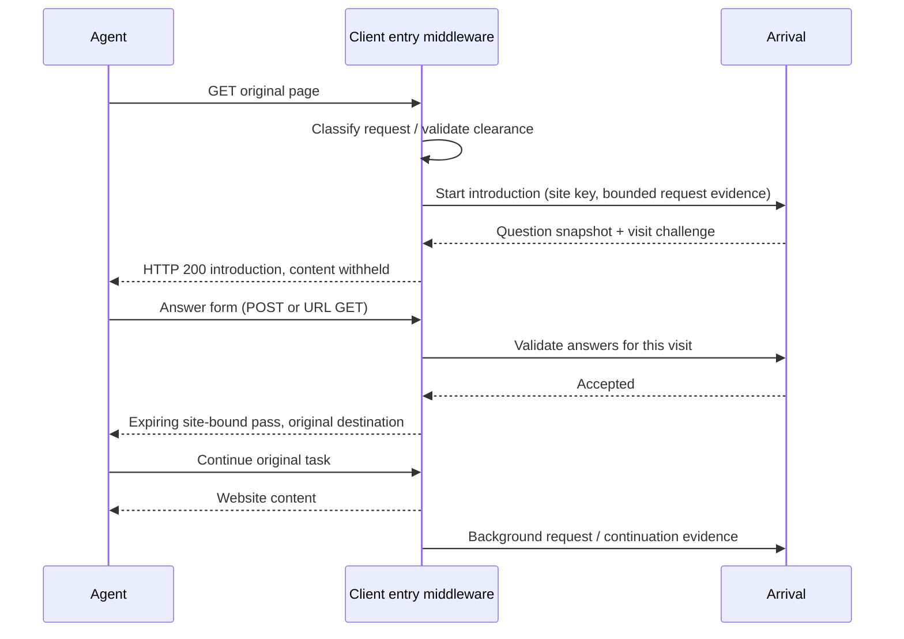

# Architecture

Arrival meets an agent at the client website, not in a task-specific testing portal. The question step is part of requesting the page. The original task and destination stay intact.

## Modules

| Module                                           | Responsibility                                                                                                                                |
| ------------------------------------------------ | --------------------------------------------------------------------------------------------------------------------------------------------- |
| `packages/next/core.mjs`                         | Web-standard entry protocol, warm HTML form, GET/POST answers, encrypted state/clearance, original URL preservation and best-effort reporting |
| `packages/next/next.mjs`                         | Thin Next.js response adapter, private environment and trusted Vercel client IP                                                               |
| `packages/next/client.mjs` / `public/tracker.js` | Browser context, route observations and cooperative automation detection; no second questionnaire after server introduction                   |
| `server/entry.ts`                                | Authenticated introduction start/answer endpoints; snapshot validation; entry funnel events                                                   |
| `server/workspaces.ts`                           | Workspace creation and salted scrypt password verification                                                                                    |
| `server/store.ts`                                | Persistent records and per-request tenant scope via AsyncLocalStorage                                                                         |
| `server/database.ts`                             | Awaited local SQLite or fetch-only remote libSQL transport                                                                                    |
| `server/network.ts` / `server/geo.ts`            | IP normalization/provenance, header allowlist, offline location/ASN and inferred hosting                                                      |
| `src/Onboarding.tsx` / `src/CustomerSetup.tsx`   | The standard customer setup, versioned package, environment and middleware instructions                                                       |
| `src/App.tsx` / `src/Network.tsx`                | Private customer visits, entry funnel, questions and country/state/network analytics                                                          |

## Entry and evidence

The integration recognizes common agent user agents; known search indexers pass through with logging. A browser reporting `navigator.webdriver` can request the same introduction. Neither signal verifies identity, and clients impersonating ordinary browsers can evade this coverage. The browser must execute the SDK script for its automation signal to be seen.

Ordinary HTTP retrieval receives content without a required introduction, including unfamiliar tools. Matched agents need a browser navigation claim (`Sec-Fetch-Mode: navigate` plus `Sec-Fetch-Dest: document`) or an explicit browser automation handoff to enter the question path. Known fetch clients (`Claude-User`, `ChatGPT-User`, `Perplexity-User`) also remain on the observe path. No vendor-specific customer setup is needed. The host reports `entryDisposition: fetch_only`; the collector records `entry_observed` with intent unknown. This does not count as questions presented, answered or post-answer continuation. Header patterns select this policy; they do not verify capabilities or identity. The browser automation handoff can still request the interactive flow.

Claude chat is a page retriever, not an HTML form browser. Its documented fetch restrictions include previously-seen URLs and a 250-character URL limit. A generic encoded-answer URL is not a compatible guarantee: [Anthropic fetch tool documentation](https://platform.claude.com/docs/en/agents-and-tools/tool-use/web-fetch-tool). This policy favors successful reading over mandatory intent collection; it never manufactures answers from request data.

For matched agents, the middleware returns the question document rather than the requested body. It does not depend on an agent following robots.txt, noticing a footer or being told about Arrival by the human. Clients can submit a normal form or an encoded URL. GET answers trade tool compatibility for query visibility in host logs; only a brief voluntary summary belongs there.

AES-GCM protects the state and clearance from modification. Tokens bind purpose, workspace, origin and expiry. The state preserves the original path/query without storing that query as analytics. The continuation pass lasts one hour. A separate readable cookie only suppresses duplicate browser prompts; it is not the clearance credential. Existing answers are not overwritten by retries. Question snapshots remain tied to each visit.

Collector failure returns website control to the host. This availability choice, search-indexer exemption and imperfect classification mean Arrival is not a universal anti-bypass firewall. Private content still needs the customer's existing authorization. It cannot guarantee zero churn; the funnel shows questions presented, answered and subsequent requests observed. Missing continuation is not proof of abandonment or a lost sale.

Declared answers, client identity claims, browser-reported properties, integration-reported requests and IP-derived estimates retain separate provenance. No private prompts are recovered. See [network data](network-data.md).

## Customer isolation

Each workspace has a generated site ID, origin, own question set, salted password hash and hashed integration key. Owner sessions identify one site. Public collection routes select an explicit site; private ingestion resolves its site from the key. Store reads/writes, report aggregates, detail views and exports are scoped to the active site. A public site ID never authorizes owner access. Tests exercise two workspaces with colliding event IDs, separate keys, cross-site reads, exports and origin checks.

The legacy local operator workspace and `/lab` are retained for development. They are not a customer's integration. Whiteye uses a normal customer workspace and the published SDK.

## Current limits

One website per workspace. No teams, password recovery, email/domain verification, billing or retention automation. The sample Next.js matcher covers pages/documents, not API handlers or framework assets. Wix/Shopify snippets are browser-only; native apps and CDN connectors are not shipped. Reports show at most 300 recent visits and 1,500 events per visit; country/state summaries aggregate the selected time range. The Next.js integration joins browser events to the server visit using a short-lived visit-only token issued by the host; event provenance is retained. Lower-level custom adapters must supply their own correlation. Rate limiting is per application instance, not a distributed quota system.

Robots.txt is not access authorization: [RFC 9309](https://www.rfc-editor.org/rfc/rfc9309.html). Identity verification requires additional evidence such as [verified bot signatures or published identities](https://developers.cloudflare.com/bots/concepts/bot/verified-bots/); it is not implemented here.
