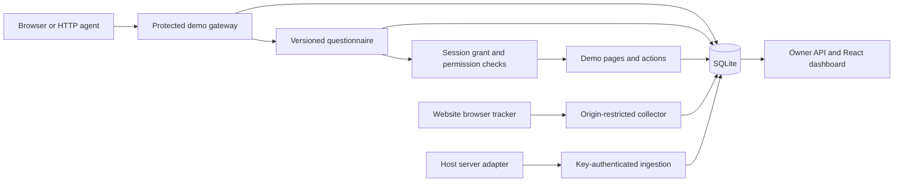

# Arrival MVP architecture

Status: implemented locally, 27 October 2026. Audience: the developer maintaining this prototype.

## Components

The Express process owns both request authorization and writes. Vite serves the React application in development; a production build is served as static files. The public landing page is `/`; the owner workspace is `/app`. The landing page uses an explicitly illustrative visit and never bootstraps an owner session or reads private workspace data. No external service is needed for the local MVP.

## Three collection paths

**Protected gateway:** `/lab` creates an opaque visit credential and records an arrival. With admission enabled, it withholds the actual content and returns a visible form or JSON challenge. Required answers are validated against the visit's saved questionnaire snapshot. Admission rotates the credential and grants `read`, and optionally `search` and `download`, for one hour. Each protected request loads the session and checks permissions. Revoked or expired grants cannot access content; the visitor must start another check-in.

**Browser collection:** `public/tracker.js` calls `/api/collect/:siteId` from the configured exact origin. A random server-issued credential is retained in per-tab session storage. Page views, bounded environment hints and annotated events are recorded. The optional form is rendered in a shadow root and can be dismissed. Answers here are declarations without access grants. Origin/CORS restrictions reduce unwanted browser collection but are not cryptographic caller authentication; an HTTP client can forge an Origin header and public telemetry.

**Server collection:** `sdk/arrival.ts` reports a finished host request to `/api/ingest` using a private ingestion key. The adapter's session ID groups requests. Event IDs are deduplicated; key rotation immediately invalidates the old key. Request metadata is marked integration-reported because this process did not observe the original connection. Reporting errors do not change the host response. There is no retry queue, so delivery is best-effort.

## Storage and provenance

`server/store.ts` creates four tables:

- `sites`: one site's origin, questionnaire, version and hashed ingestion key.
- `sessions`: hashed credential, source, timestamps, context, questionnaire snapshot, answers, classification and grants.
- `events`: append-only observations with method/path/status, provenance and deduplication key.
- `admin_sessions`: hashed owner credentials with eight-hour expiry.

The database uses WAL and prepared statements. Credentials are never returned through owner session inspection or exports. A question edit affects new visits; historical answers retain their original question wording and options.

Detection in `server/signals.ts` is deliberately explainable: known self-identifying user-agent strings and basic browser automation hints. `unknown` is an ordinary outcome. No classifier score or verified-agent badge is fabricated. The controlled runner makes actual HTTP requests but can declare its own name; it is still not cryptographically verified.

## Access and failure behavior

Owner APIs require an owner session. Direct localhost bootstrapping is available only without `ADMIN_PASSWORD`, with both loopback connection and localhost Host checks. Mutations reject foreign origins. A configured password disables local bootstrap. A deployment binding a public interface must configure a password; HTTPS/trusted proxy setup remains the deployer's responsibility.

Request bodies, questions, answers and event fields are bounded. Unknown answer keys, invalid choice values and incomplete required answers are rejected. Protected responses are not cacheable. A browser failing to execute telemetry can still complete the server questionnaire. Tracking failures must not be interpreted as proof of hostile automation.

Session revocation invalidates one grant, not an agent identity. The same caller may start a new questionnaire. Preventing that requires stronger identity and policy, not simply a browser fingerprint.

## MVP limits and next decisions

There is one owner/site, synchronous SQLite storage, local rate limiting and no durable ingestion queue, retention automation, identity verification or third-party WAF integration. Dashboard and JSON/CSV exports show the latest 300 visits; timeline inspection caps at 1,500 events. The database retains records beyond those limits.

Before production use, decide whether admission is mandatory on protected operations or voluntary for analytics. Add tenant authorization, durable collection, retention controls and measured false-positive handling before expanding deployment. Operator authentication (for example signed-agent verification) should be a separate module from task answers and authorization.

Relevant boundaries: [OWASP authorization](https://cheatsheetseries.owasp.org/cheatsheets/Authorization_Cheat_Sheet.html), [HTTP Message Signatures](https://www.rfc-editor.org/rfc/rfc9421.html), [Cloudflare JavaScript detection limits](https://developers.cloudflare.com/cloudflare-challenges/challenge-types/javascript-detections/).
